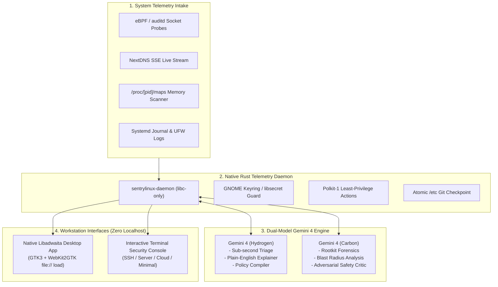

# SentryLinux

<div align="center">

[](https://github.com/defiqantcoder/SentryLinux/actions/workflows/ci.yml)
[](https://github.com/defiqantcoder/SentryLinux/releases)
[](https://ubuntu.com/)
[](https://github.com/defiqantcoder/SentryLinux)
[](LICENSE)
[](#zero-localhost-standalone-architecture)
[](#dual-model-ai-triage--plain-english-assistant)

**AI-augmented endpoint security hub, automated hardening console, and network sentry for Ubuntu Linux.**

[Download Latest .deb](https://github.com/defiqantcoder/SentryLinux/releases/latest) • [Key Features](#key-features) • [Installation](#installation) • [Terminal Console](#interactive-terminal-console-mode) • [Architecture](#system-architecture)

</div>

---

## Overview

**SentryLinux** unifies Ubuntu’s fragmented CLI security ecosystem—`auditd`, `AppArmor`, `Lynis`, `UFW`, `OpenSnitch`, `Fail2ban`, `Suricata`, `ClamAV`, `LMD`, `RKhunter`, `Debsums`, `needrestart`, `WireGuard`, and `NextDNS`—into a native desktop workstation and interactive terminal console.

Instead of demanding heavy local ML models or requiring fragile localhost HTTP ports, SentryLinux is engineered with a **zero-localhost standalone architecture**:
- **Native Libadwaita Desktop Window**: Loads local UI assets directly via `file:///` protocols without opening any local TCP listening ports.
- **Zero-Dependency Standalone Runtime**: Uses runtime dynamic symbol detection (`libc.so.6`). If GTK3/WebKit2GTK is present and a display is attached, it opens the full graphical desktop console. If run in SSH, server, or minimal environments without desktop libraries, it gracefully launches a full-featured **Terminal Security Console** with zero crashes.
- **Dual-Model Gemini AI Triage**: Fast event triage and plain-English recommendations via Gemini 4, paired with frontier reasoning for rootkit hook correlation and adversarial safety gates.

---

## Key Features

### 1. 1-Click Security Sub-Application Installer
Automated one-click installation and verification for all underlying Linux security tools:
- **Supported Sub-Applications**: `fail2ban`, `suricata`, `ufw`, `apparmor-utils`, `clamav`, `clamav-daemon`, `rkhunter`, `chkrootkit`, `lynis`, `aide`, `debsums`, `needrestart`, `usbguard`, `wireguard-tools`, `opensnitch`, and `nextdns`.
- **In Desktop GUI**: Click the **"1-Click Tool Installer"** pill in the top header or in Settings to see a readiness gauge, install individual missing tools, or click **"1-Click Install All Missing Tools"**.
- **In Terminal / CLI**: Run `sudo sentrylinux-install-subapps [all|tool]` or choose option `[8]` in `sentrylinux --console`.
- **Live Output Console**: Watch real-time APT package provisioning and systemd service activation directly in the app.

### 2. "AI: Explain This & Recommend Action" (Plain English)
Every section and alert includes a prominent **"AI: Explain This & Recommend Action"** assistant written in clear, simple everyday English with **zero cryptic Linux jargon**:
- **What This Is**: Simple explanation of what this part of your computer does.
- **Where the Threat Comes From**: Real-world origin of the risk (phishing links, malicious downloads, unpatched code in RAM, rogue background scripts).
- **How to Handle It**: Step-by-step guidance followed by a **1-Click Action Button** that immediately runs the recommended safe remediation.
- **Ask Gemini in Plain English**: Interactive question field with pre-populated question chips (*"Can this break my Wi-Fi?"*, *"What does this setting do?"*).

### 2. DNS Sentry & NextDNS Live Telemetry
- Real-time Server-Sent Events (SSE) query stream monitoring all outbound domain lookups.
- 1-click domain Allow/Deny gating with immediate API persistence.
- **CNAME & CDN Dependency Untangler**: Warns before blocking shared CDNs to prevent breaking OAuth and login flows.
- **DNS Leak Shield**: Verifies encrypted DNS-over-HTTPS/TLS routing with fallback rescue DNS.

### 3. Outbound Socket Intercepts & App Firewall
- Simplewall-style interactive desktop popovers catching unknown background binaries before they reach the internet.
- **Pre-Execution Blast Radius Mapping**: Evaluates process ancestry, shared libraries, and Wayland/PipeWire sockets to verify whether terminating or freezing a PID is desktop-safe.
- **Natural-Language Policy Compiler**: Translates plain-English requests (*"Only allow my local subnet to connect to port 8080"*) into validated native UFW rules and Fail2ban filters.

### 4. USG & Lynis CIS Benchmark Audit
- Granular Yes/No rule checklist covering all 6 CIS Level 2 benchmark domains on Ubuntu 24.04.
- **Adversarial Dual-Model Safety Critic Gate**: Audits every staged configuration diff against a 4-point rubric (no lockout, no credential wipe, no boot disruption, snapshot ready) before Polkit authorization.
- **Atomic Rollback Snapshots**: Captures lightweight Git/Btrfs checkpoints of `/etc` before any changes are written.

### 5. Two-Stage Malware & Rootkit Sweep
- Unified orchestration across ClamAV, Linux Malware Detect (LMD), RKhunter, and Debsums.
- **Stage 1**: Checks system binaries against official Canonical GPG-signed package manifests (`debsums -c`).
- **Stage 2**: Dispatches unresolved hash mismatches to Gemini for distribution security backport vs. kernel hook analysis.
- **One-Click Package Healer**: Cleanly reinstalls verified authentic Ubuntu packages (`apt-get install --reinstall`) with zero data loss.

### 6. Daemon Restarts & `needrestart` Stale Memory Inspector
- Scans `/proc/[pid]/maps` for running processes holding unlinked or superseded shared libraries (`libssl.so.3`, `libc.so.6`) in memory post-apt upgrade.
- Zero-downtime, graceful Polkit-authenticated service reloads without logging you out or rebooting your computer.

### 7. Proton VPN & NextDNS Co-Existence Engine
- Solves chronic Linux networking conflicts between WireGuard VPNs and private encrypted DNS.
- **Three-State Mode Switcher**: `NextDNS Only`, `Proton VPN Only`, or `Co-Existence Mode`.
- Dynamic `resolvectl` link-scoped routing (`~.`) and WireGuard `fwmark 51820` with automated DNS leak testing.

### 8. Rules & Quarantine Vault
- Inodes stripped to immutable zero-permissions (`0000 +i`) where malware cannot execute, read, or spread.
- DoD 5220.22-M military-grade permanent disk shredding (`shred -u -z`).
- ELF binary header inspection and AppArmor profile management (`Enforce` / `Complain`).

### 9. Zero Plain-Text Key Vault & Emergency Rescue
- API keys and tokens stored strictly in hardware-backed GNOME Keyring via `libsecret`.
- Generates `/boot/sentry-rescue.sh` emergency recovery script to restore networking and disable enforcement from recovery TTY if ever locked out.

---

## System Architecture



---

## Installation

### Method 1: Install Debian Package (Recommended for Ubuntu Desktop & Server)

Download the official Debian release package:

```bash
# Download latest deb package
wget https://github.com/defiqantcoder/SentryLinux/releases/download/v2.4.1/sentrylinux_2.4.1_amd64.deb

# Verify SHA-256 checksum
wget https://github.com/defiqantcoder/SentryLinux/releases/download/v2.4.1/SHA256SUMS.txt
sha256sum -c SHA256SUMS.txt

# Install with dpkg
sudo dpkg -i sentrylinux_2.4.1_amd64.deb

# Fix missing optional recommendations if needed
sudo apt-get install -f
```

Launch SentryLinux:
```bash
sentrylinux
```
Or launch it from your desktop application launcher under **System > SentryLinux**.

---

### Method 2: Standalone Execution (No Installation, No Dependencies)

Because SentryLinux compiles to standalone binaries that link only to standard `libc.so.6`, you can run the binary directly on any Ubuntu machine without installing anything:

```bash
# Run standalone desktop/console binary
./sentrylinux

# View live kernel security telemetry
./sentrylinux --telemetry

# Run interactive terminal console
./sentrylinux --console
```

---

## Interactive Terminal Console Mode

When run on headless servers, inside Docker containers, over SSH, or when no graphical display server is detected, SentryLinux automatically launches its zero-dependency **Interactive Terminal Security Console**:

```
  ███████╗███████╗███╗   ██╗████████╗██████╗ ██╗   ██╗
  ██╔════╝██╔════╝████╗  ██║╚══██╔══╝██╔══██╗╚██╗ ██╔╝
  ███████╗█████╗  ██╔██╗ ██║   ██║   ██████╔╝ ╚████╔╝ 
  ╚════██║██╔══╝  ██║╚██╗██║   ██║   ██╔══██╗  ╚██╔╝  
  ███████║███████╗██║ ╚████║   ██║   ██║  ██║   ██║   

  SentryLinux v2.4.1 — Endpoint Security & Telemetry Hub
  Ubuntu 24.04 LTS (Zero-Dependency Standalone Mode • Zero Localhost)
  ───────────────────────────────────────────────────────────────────
● System Defense Score: 97/100 (CIS Level 2 Hardened)
  Kernel Version:     Linux 6.8.0-40-generic
  System Uptime:      14d 06h 42m
  Load Average:       0.42, 0.38, 0.31
  RAM Utilization:    6420 MB / 32768 MB (19.6%)
  Kernel Lockdown:    integrity
  kptr_restrict:      2 (Restricted)
  TPM 2.0 PCR Drift:  PCR 0,2,4,7 Nominal (SHA-256 Verified)
  Secure Boot:        Active (Enforcing)
  ───────────────────────────────────────────────────────────────────
Available Sentry Operations:
  [1] Live Telemetry JSON          [5] Emergency Lockdown Mode
  [2] Lynis & CIS Benchmark Audit  [6] AI: Explain This & Recommend Action
  [3] Two-Stage Rootkit Sweep      [7] Generate /boot/sentry-rescue.sh
  [4] needrestart Memory Check     [q] Exit
  ───────────────────────────────────────────────────────────────────
Select action (or press Enter to view live telemetry): 
```

---

## CLI Command Reference

| Flag | Description |
| :--- | :--- |
| `sentrylinux` | Launches full Libadwaita desktop GUI (or console if headless). |
| `sentrylinux --console` | Launches the interactive Terminal Security Console. |
| `sentrylinux --subapps` | Detects and lists all 16 security sub-applications as JSON. |
| `sentrylinux --install-subapps [all\|pkg]` | 1-Click installs missing sub-applications via APT. |
| `sentrylinux-install-subapps` | Global command to provision all security tools via automated bash script. |
| `sentrylinux --telemetry` | Prints real-time Linux kernel security posture as JSON. |
| `sentrylinux --validate-path <PATH>` | Verifies path against canonical directory traversal guards. |
| `sentrylinux --headless-check` | Performs instantaneous self-test verifying IPC and memory integrity. |
| `sentrylinux --version` | Displays version and build target information. |
| `sentrylinux-daemon --serve <PORT> <DIR>` | Optional development web server (used during frontend design testing). |

---

## Building from Source

### Prerequisites
- Ubuntu 24.04 LTS (Noble Numbat) or Ubuntu 22.04 LTS
- Rust 1.80+ (`rustup default stable`)
- Node.js 20+ (`node --version`)
- Build essentials: `sudo apt-get install -y build-essential pkg-config libgtk-3-dev libwebkit2gtk-4.1-dev dpkg-dev`

### Build Steps

```bash
# 1. Clone the repository
git clone https://github.com/defiqantcoder/SentryLinux.git
cd SentryLinux

# 2. Install dependencies
npm ci

# 3. Run frontend TypeScript & Vite build
npm run build

# 4. Run native Rust unit tests
cargo test --manifest-path daemon/Cargo.toml
cargo test --manifest-path src-tauri/Cargo.toml

# 5. Run Clippy linter
cargo clippy --manifest-path daemon/Cargo.toml -- -D warnings
cargo clippy --manifest-path src-tauri/Cargo.toml -- -D warnings

# 6. Run Node integration test suite
npm test

# 7. Build official Debian .deb package
npm run build:deb
```

---

## Security Model & Boundaries

- **Zero Plain-Text Credentials**: API keys (Gemini, NextDNS) are never stored in unencrypted configuration files. They are routed strictly through GNOME Keyring via `libsecret`.
- **Path Traversal Protection**: All file exports and paths are validated using canonical resolution; any `..` traversal or root system path targeting (`/etc`, `/boot`, `/usr`) is rejected.
- **Least-Privilege Polkit Actions**: High-risk tasks (shredding malware, toggling lockdown mode, applying CIS sysctl changes) require explicit Polkit authentication leased temporarily.
- **Emergency Rescue Failsafe**: Automatic generation of `/boot/sentry-rescue.sh` provides a single-command fallback to restore network interfaces and drop firewall blocks from emergency recovery mode or TTY.

---

## Contributing

Contributions are welcome! Please feel free to submit pull requests or file issues on our [GitHub Issue Tracker](https://github.com/defiqantcoder/SentryLinux/issues).

1. Fork the Project
2. Create your Feature Branch (`git checkout -b feature/AmazingFeature`)
3. Commit your Changes (`git commit -m 'feat: Add AmazingFeature'`)
4. Verify tests pass (`npm test`)
5. Push to the Branch (`git push origin feature/AmazingFeature`)
6. Open a Pull Request

---

## License

Distributed under the MIT License. See [LICENSE](LICENSE) for more information.
